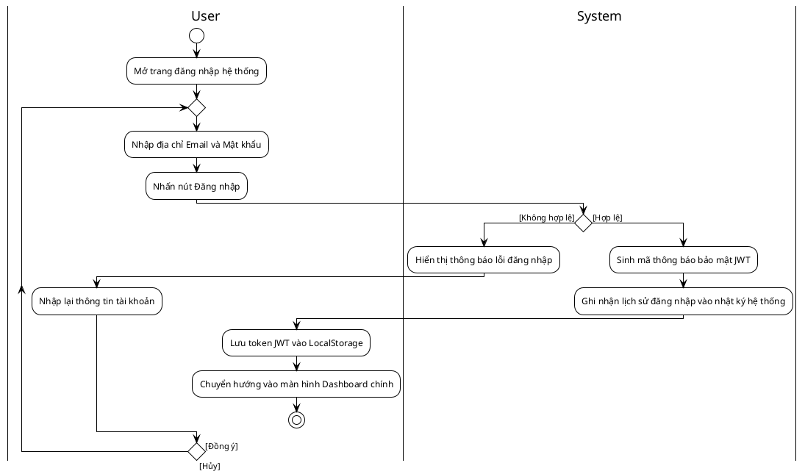
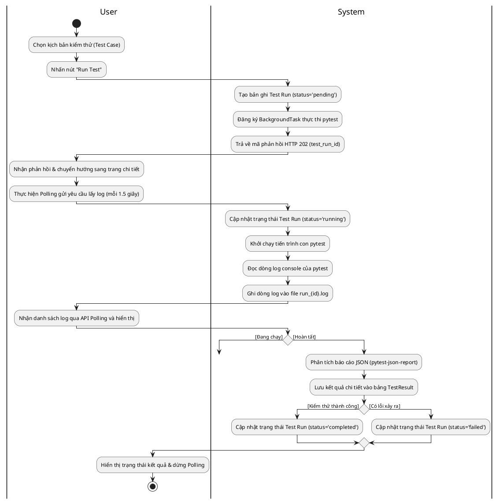
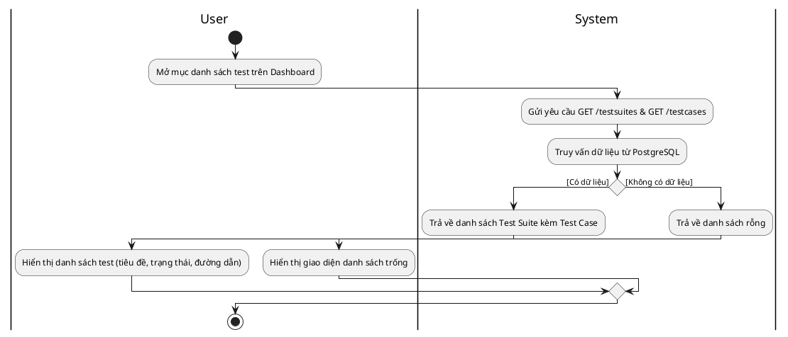
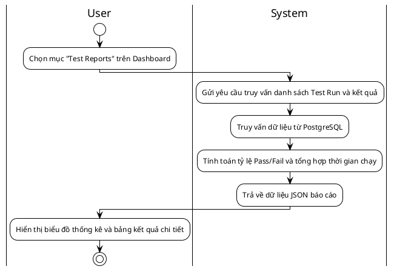
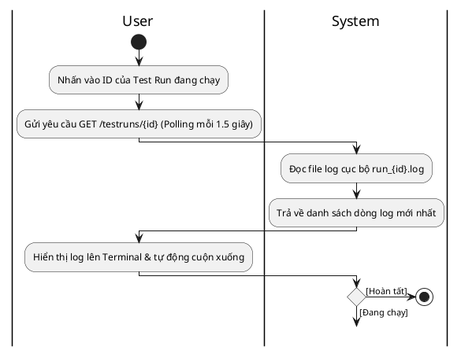
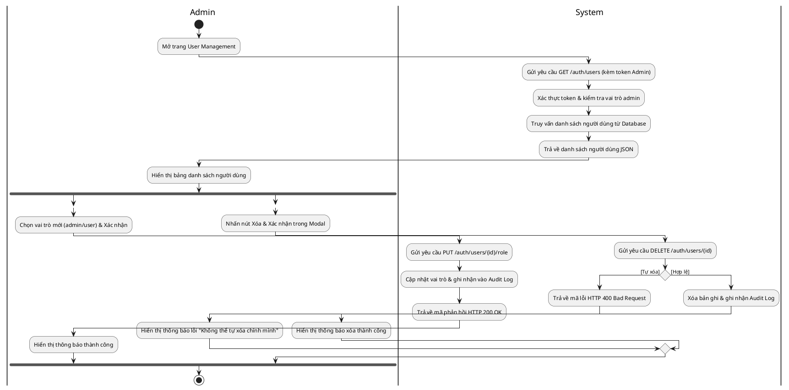
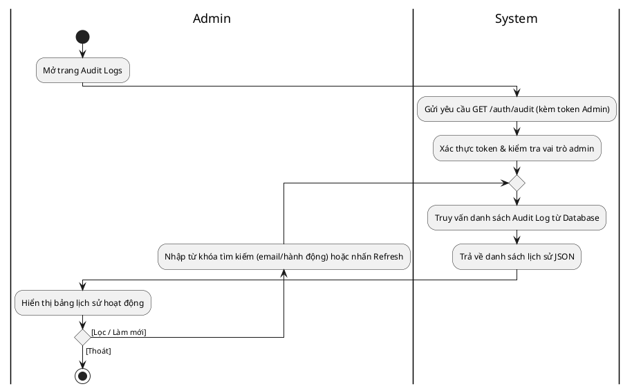

# 🗺️ BẢN VẼ ACTIVITY DIAGRAM (SƠ ĐỒ HOẠT ĐỘNG) CHUẨN PLANTUML

Tài liệu này chứa mã nguồn **PlantUML** cho sơ đồ hoạt động (Activity Diagram) của các Use Case trong hệ thống **EduMaster Auto QA**. Các sơ đồ sử dụng cú pháp làn bơi phân làn (`|User|` và `|System|`) để hiển thị luồng chạy một cách rõ ràng và khoa học nhất.

---

## UC1: Xác thực người dùng (Đăng nhập)

Đây là sơ đồ hoạt động đã được vẽ với làn bơi User/System sạch sẽ và **mũi tên nét mảnh/mở** đúng theo yêu cầu của bạn:

### Mã nguồn PlantUML của sơ đồ trên:

---

## UC2: Kích hoạt Test thủ công & Theo dõi Log (Polling)

Đây là sơ đồ hoạt động đã được vẽ với làn bơi User/System sạch sẽ, **mũi tên nét mảnh/mở** và **mũi tên quay lui đâm thẳng vào hình chữ nhật** đúng theo yêu cầu của bạn:

### Mã nguồn PlantUML của sơ đồ trên:

---

## UC3: Xem danh sách bộ test

---

## UC4: Xem kết quả & Thống kê

Đây là sơ đồ hoạt động mô tả luồng lấy và hiển thị dữ liệu báo cáo thống kê:

### Mã nguồn PlantUML của sơ đồ trên:

---

## UC5: Theo dõi Log real-time (Polling logs)

Đây là sơ đồ hoạt động mô tả luồng polling logs thời gian thực:

### Mã nguồn PlantUML của sơ đồ trên:

---

## UC6: Quản lý Người dùng (Admin)

Đây là sơ đồ hoạt động mô tả luồng quản lý tài khoản người dùng của đặc quyền Admin:

### Mã nguồn PlantUML của sơ đồ trên:

---

## UC7: Xem lịch sử hệ thống (Audit Logs - Admin)

Đây là sơ đồ hoạt động mô tả luồng kiểm tra lịch sử thao tác hệ thống của đặc quyền Admin:

### Mã nguồn PlantUML của sơ đồ trên:

