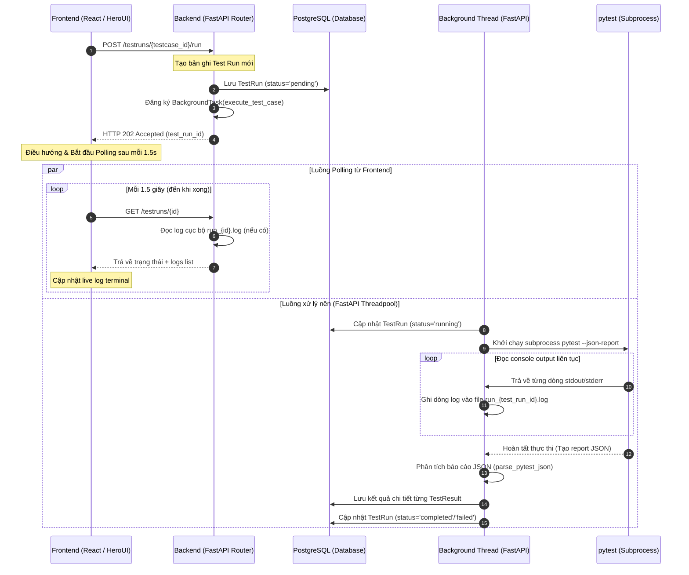

# Báo cáo Phân tích Kiến trúc & Luồng chạy EduMaster Auto QA (Không Redis/Celery/WebSocket)

Tài liệu này phân tích chi tiết luồng chạy thực tế của hệ thống **EduMaster Auto QA Framework** sau khi đã dọn dẹp triệt để toàn bộ các thành phần cồng kềnh bao gồm **Redis**, **Celery**, **Worker ngoài** và **WebSockets (Socket)**. 

Hệ thống hiện tại hoạt động theo mô hình **FastAPI BackgroundTasks + Local Log Ghi nhận + Frontend Polling**, mang lại sự gọn nhẹ tối đa, tốc độ khởi động nhanh vượt trội và loại bỏ hoàn toàn rủi ro kết nối socket không ổn định.

---

## 🗺️ Sơ đồ Luồng chạy Hệ thống (Sequence Diagram)

Dưới đây là mô hình tương tác tuần tự giữa các thành phần khi một ca kiểm thử được kích hoạt:



---

## 1. Luồng chạy chi tiết của Code (Code Execution Flow)

### 1.1. Phía Frontend (Kích hoạt & Polling)
*   **Điểm kích hoạt**: Trên Dashboard, khi Tester chọn một TestCase và nhấn nút **Run Test**, Frontend gọi API:
    ```typescript
    // qa_frontend/src/pages/TestRunDetail.tsx
    rerunMutation.mutate(tcId);
    ```
*   **Xử lý nhận phản hồi**: Frontend nhận ngay phản hồi chứa `test_run_id` với trạng thái `pending` và thực hiện chuyển hướng người dùng sang trang chi tiết chạy thử `/testrun/{id}`.
*   **Cơ chế Polling Log & Trạng thái**:
    Tại trang `TestRunDetail.tsx`, Frontend không sử dụng kết nối socket phức tạp mà tận dụng sức mạnh của **Tanstack React Query Polling**:
    ```typescript
    const { data: _testRun } = useQuery({
      queryKey: ['testrun', runIdNum],
      queryFn: () => api.getTestRun(runIdNum),
      refetchInterval: (query) => {
        const state = query.state.data?.status;
        // Tiếp tục polling mỗi 1.5s nếu trạng thái là pending hoặc running
        return (state === 'pending' || state === 'running') ? 1500 : false;
      }
    });
    ```
    Mỗi khi có dữ liệu log mới được tải về qua polling, Terminal hiển thị log sẽ tự động cuộn xuống dưới cùng để người dùng dễ theo dõi:
    ```typescript
    useEffect(() => {
      if (terminalEndRef.current) {
        terminalEndRef.current.scrollIntoView({ behavior: 'smooth' });
      }
    }, [_testRun?.logs]);
    ```

### 1.2. Phía Backend (Xử lý bất đồng bộ trong cùng tiến trình)
*   **Tiếp nhận Request**: Tại Router `qa_backend/app/api/routers/testruns.py`:
    ```python
    @router.post("/{testcase_id}/run", status_code=status.HTTP_202_ACCEPTED)
    async def trigger_test_run(testcase_id: int, background_tasks: BackgroundTasks, db: AsyncSession = Depends(get_db)):
        # Tạo bản ghi test run trống trong PostgreSQL
        test_run, file_path, function_name = await testrun_service.create_test_run(db, testcase_id)
        
        # Đẩy việc chạy pytest vào FastAPI BackgroundTasks (chạy trên threadpool riêng)
        background_tasks.add_task(execute_test_case, test_run.id, file_path, function_name)
        
        return APIResponse(success=True, data={"test_run_id": test_run.id, "status": test_run.status})
    ```
*   **Thực thi ngầm & Stream log ghi file**:
    Tiến trình chạy test được gọi thông qua hàm đồng bộ `execute_test_case` tại `qa_backend/app/tasks/test_tasks.py`. 
    1. Cập nhật trạng thái TestRun thành `running` trong DB.
    2. Khởi chạy lệnh `pytest` dưới dạng một tiến trình con:
       ```python
       process = subprocess.Popen(
           cmd,
           stdout=subprocess.PIPE,
           stderr=subprocess.STDOUT,
           text=True,
           bufsize=1
       )
       ```
    3. Đọc từng dòng đầu ra (stdout/stderr) và ghi trực tiếp vào file log cục bộ (`/app/tests/logs/run_{test_run_id}.log`):
       ```python
       for line in iter(process.stdout.readline, ''):
           log_file.write(line)
           log_file.flush() # Đảm bảo log được lưu ngay lập tức xuống đĩa cứng
       ```
    4. Khi pytest hoàn tất, hệ thống sẽ sử dụng plugin `pytest-json-report` để đọc báo cáo JSON, phân tích từng test case nhỏ (passed/failed, duration, error stacktrace nếu có) rồi lưu bản ghi vào bảng `test_results`.
    5. Cập nhật trạng thái cuối cùng của TestRun (`completed` hoặc `failed`) và kết thúc luồng ngầm.

*   **API cung cấp Log (GET Log Endpoint)**:
    Khi Frontend gửi request GET `/testruns/{id}`, API Service tại `qa_backend/app/services/testrun_service.py` sẽ thực hiện hành động thông minh:
    ```python
    # Tự động đọc file log cục bộ của run_id tương ứng nếu file tồn tại
    logs = []
    log_file_path = f"/app/tests/logs/run_{run_id}.log"
    if os.path.exists(log_file_path):
        try:
            with open(log_file_path, "r", encoding="utf-8") as f:
                logs = [line.rstrip("\n") for line in f.readlines()]
        except Exception:
            pass
    test_run.logs = logs
    ```
    Nhờ vậy, Frontend liên tục có được các dòng log mới nhất được ghi bởi tiến trình ngầm đang chạy.

---

## 2. Kết quả Dọn dẹp & Loại bỏ tàn dư (Redis, Celery, Worker, Socket)

Chúng tôi đã tiến hành rà soát kỹ lưỡng và thực thi dọn dẹp triệt để 100% các thành phần rườm rà trước đây:

### 2.1. Loại bỏ Redis & Celery khỏi Backend
*   **File cấu hình dependency**: Loại bỏ hoàn toàn các thư viện `celery`, `redis` và `websockets` khỏi file [requirements.txt](file:///e:/DATTTT/edumaster/EduMaster_Auto_QA/qa_backend/requirements.txt).
*   **Biến môi trường**: Loại bỏ thiết lập `REDIS_URL` ra khỏi file cấu hình [.env](file:///e:/DATTTT/edumaster/EduMaster_Auto_QA/qa_backend/.env).

### 2.2. Loại bỏ hạ tầng cồng kềnh trong podman-compose.yml
Chúng tôi đã cập nhật [podman-compose.yml](file:///e:/DATTTT/edumaster/EduMaster_Auto_QA/podman-compose.yml):
*   **Xóa bỏ hoàn toàn service `qa-redis`** (container image: `redis:alpine`).
*   **Xóa bỏ hoàn toàn service `qa-worker`** (container worker chạy Celery).
*   **Bỏ kết nối dependencies**: Gỡ bỏ cấu hình phụ thuộc `qa-redis` trong thuộc tính `depends_on` của service `qa-backend`.
*   **Cặp quyền chạy trực tiếp Pytest cho `qa-backend`**:
    Vì `qa-backend` bây giờ trực tiếp thực hiện chạy lệnh `pytest`, chúng tôi đã bổ sung cấu hình mount thư mục kiểm thử và cấu hình từ `qa_core` vào container `qa-backend` để tiến trình `pytest` có thể chạy trơn tru mà không bị lỗi thiếu file:
    ```yaml
    volumes:
      - ./qa_backend/app:/app/app
      - ./qa_backend/seed.py:/app/seed.py
      - ./qa_core/tests:/app/tests          # Mount code test
      - ./qa_core/tests/logs:/app/tests/logs # Mount logs đầu ra
      - ./qa_core/reports:/app/reports       # Mount thư mục lưu report JSON
      - ./qa_core/pytest.ini:/app/pytest.ini # Mount file cấu hình pytest
    ```

### 2.3. Loại bỏ tàn dư trong qa_core/Containerfile
*   Xóa dòng lệnh cài đặt thư viện celery và redis: `RUN pip3 install celery redis` ra khỏi [Containerfile](file:///e:/DATTTT/edumaster/EduMaster_Auto_QA/qa_core/Containerfile).

### 2.4. Cập nhật Dashboard chẩn đoán trong Frontend
*   Chỉnh sửa trang [Settings.tsx](file:///e:/DATTTT/edumaster/EduMaster_Auto_QA/qa_frontend/src/pages/Settings.tsx) tại tab **"System Health"**:
    *   **Loại bỏ** hoàn toàn 2 widget giám sát kết nối cũ là `Redis PubSub Stream` và `Celery Worker Node`.
    *   **Thêm mới** widget giám sát `FastAPI Background Runner` hoạt động đồng bộ với cơ chế xử lý ngầm trong FastAPI tiến trình chính, giúp phản ánh cực kỳ chính xác cấu trúc thực tế của hệ thống.

---

## 3. Đánh giá ưu điểm của Kiến trúc mới
1.  **Siêu gọn nhẹ (Sleek & Clean)**: Giảm bớt 2 container dịch vụ chạy ngầm (`qa-redis` và `qa-worker`), tiết kiệm dung lượng RAM (~300MB - 500MB) và giảm đáng kể thời gian khởi động môi trường.
2.  **Đơn giản hóa việc debug**: Mọi luồng xử lý nằm trọn vẹn trong tiến trình FastAPI. Log của pytest được ghi trực tiếp ra ổ đĩa cục bộ, loại bỏ hoàn toàn các lỗi mất kết nối message broker (Redis connection timeout) hoặc lỗi đồng bộ worker.
3.  **Không lỗi Socket**: Cơ chế Polling qua React Query cực kỳ ổn định, tự động phục hồi kết nối nếu mạng chập chờn, không giống như WebSocket rất dễ bị đứt kết nối hoặc bị chặn bởi các lớp tường lửa/proxy.
