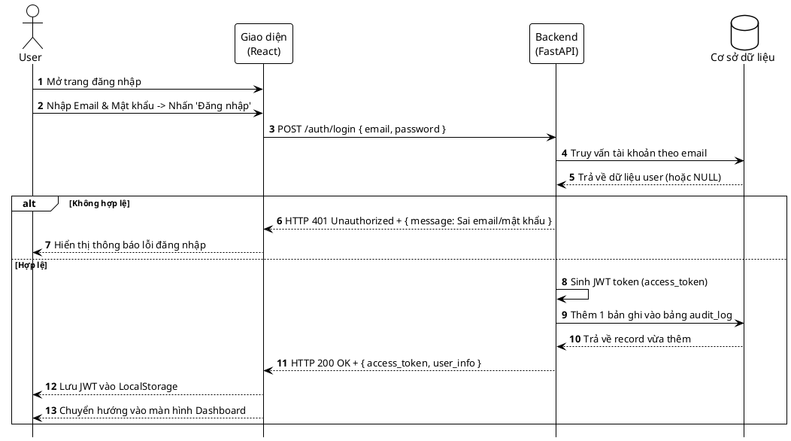
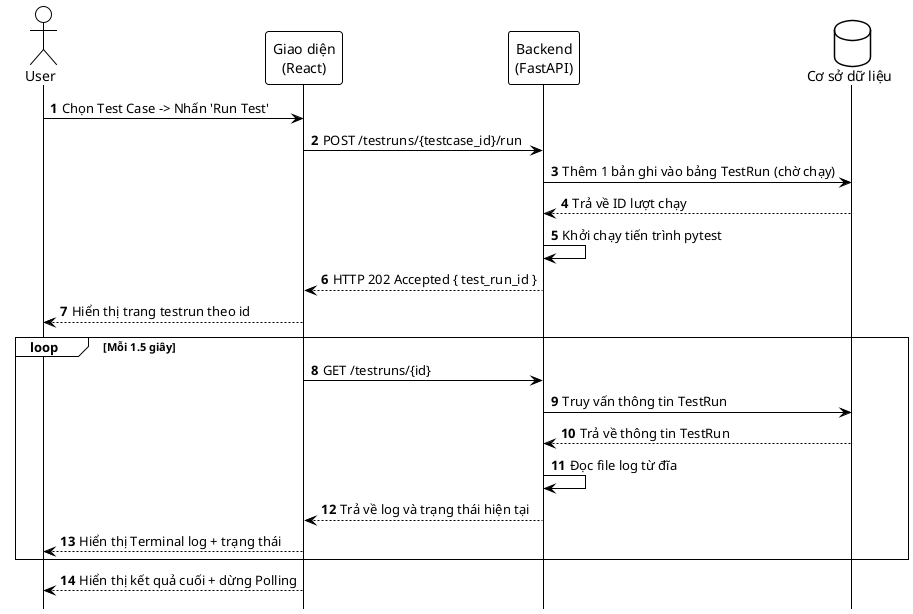
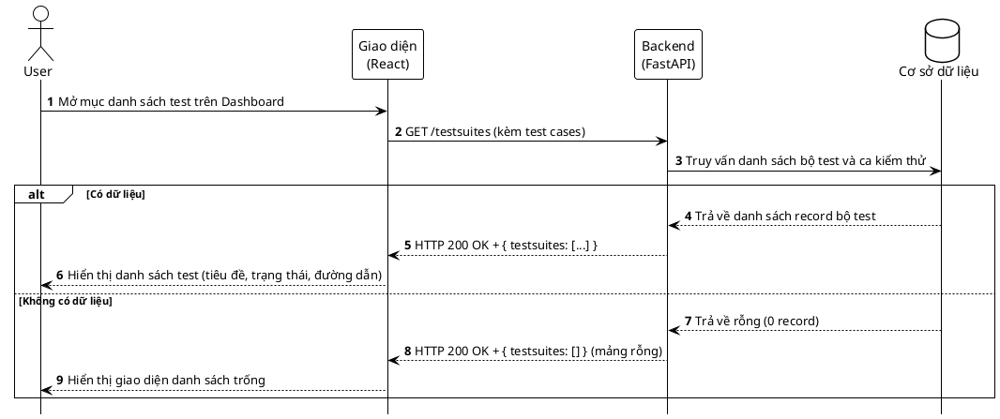
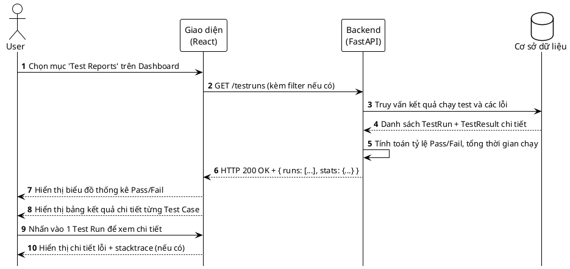
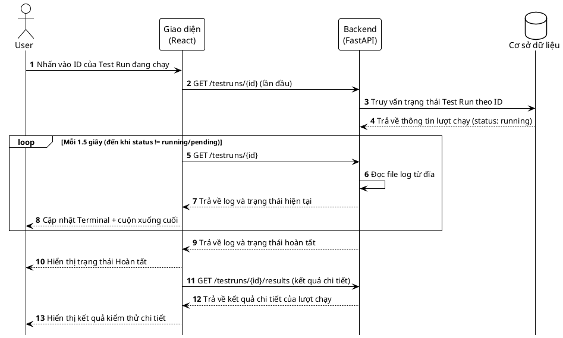
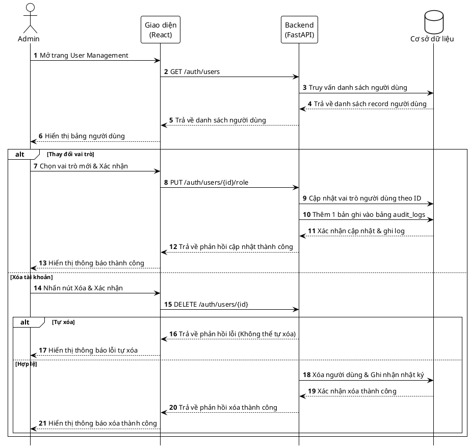
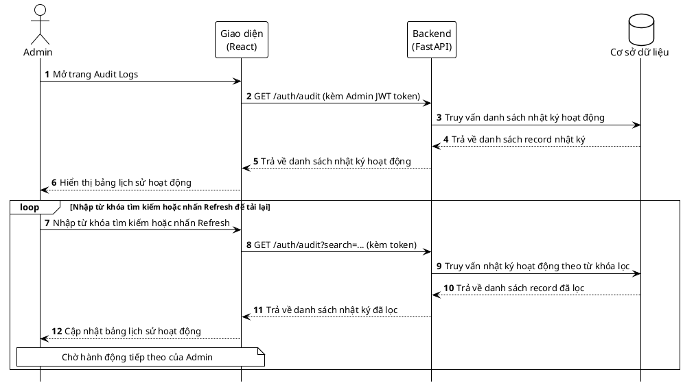

# 🗺️ BẢN VẼ SEQUENCE DIAGRAM (SƠ ĐỒ TRÌNH TỰ) CHI TIẾT

Tài liệu này chứa các sơ đồ trình tự (Sequence Diagram) mô tả chi tiết tương tác giữa các thành phần (Browser, Frontend React, Backend FastAPI Router, FastAPI Background Thread, Database PostgreSQL, và pytest) cho 7 Use Case (bao gồm 5 Use Case người dùng và 2 Use Case quản trị) của hệ thống **EduMaster Auto QA**.

Các sơ đồ đã được vẽ chi tiết, căn chỉnh kích thước và xuất thành hình ảnh PNG chất lượng cao lưu trong thư mục hệ thống.

---

## UC1: Xác thực người dùng (Đăng nhập)

Sơ đồ trình tự mô tả luồng xác thực, kiểm tra thông tin tài khoản, ghi nhận Audit Log khi đăng nhập thành công và trả về mã thông báo JWT.

### Mã nguồn PlantUML:

### Các bước thực thi chi tiết:
1. **Mở trang đăng nhập:** User truy cập trang Đăng nhập trên Browser.
2. **Gửi thông tin:** Nhập Email & Mật khẩu và nhấn nút Đăng nhập.
3. **POST /auth/login:** Frontend React gửi thông tin đăng nhập đến Backend FastAPI.
4. **Truy vấn Database:** Backend gửi truy vấn thông tin tài khoản theo email tới Cơ sở dữ liệu.
5. **Trả về User Info:** Cơ sở dữ liệu trả về thông tin người dùng (hoặc NULL nếu không tồn tại).
6. **Xử lý kết quả:**
   - **Nhánh Không hợp lệ:** Backend trả về `HTTP 401 Unauthorized`. Frontend hiển thị thông báo lỗi và yêu cầu nhập lại.
   - **Nhánh Hợp lệ:** Backend sinh mã thông báo JWT, thêm 1 bản ghi vào bảng audit_log, nhận phản hồi trả về record vừa thêm và trả về `HTTP 200 OK` kèm JWT.
7. **Lưu Token:** Frontend lưu JWT vào LocalStorage.
8. **Chuyển hướng:** Frontend chuyển hướng người dùng sang trang Dashboard chính.

---

## UC2: Kích hoạt Test thủ công & Theo dõi Log (Polling)

Sơ đồ trình tự mô tả luồng kích hoạt kiểm thử bất đồng bộ sử dụng FastAPI Background Tasks, cùng cơ chế Polling log và trạng thái song song từ Frontend.

### Mã nguồn PlantUML:

### Các bước thực thi chi tiết:
1. **Kích hoạt chạy test:** User chọn Test Case và nhấn "Run Test".
2. **POST /testruns/{id}/run:** Frontend gửi yêu cầu chạy test đến Backend.
3. **Khởi tạo trạng thái:** Backend thêm 1 bản ghi vào bảng TestRun (chờ chạy).
4. **Trả về ID lượt chạy:** Cơ sở dữ liệu lưu và trả về ID lượt chạy mới.
5. **Khởi chạy pytest:** Backend khởi chạy một tiến trình con pytest chạy ngầm (bất đồng bộ).
6. **Phản hồi nhanh:** Backend trả về `HTTP 202 Accepted` ngay lập tức để giải phóng giao diện.
7. **Điều hướng:** Frontend hiển thị trang chi tiết chạy test theo ID và bắt đầu cơ chế Polling:
   - **Vòng lặp Polling (mỗi 1.5 giây):** Frontend gửi `GET /testruns/{id}`. Backend thực hiện truy vấn thông tin TestRun từ Cơ sở dữ liệu để lấy trạng thái, sau đó tự đọc file log cục bộ (`run_{id}.log`) từ đĩa, rồi phản hồi lại cho Giao diện để hiển thị Terminal log và trạng thái hiện tại lên màn hình.
8. **Dừng Polling:** Khi trạng thái Test Run chuyển thành kết thúc (`completed` hoặc `failed`), Frontend nhận phản hồi cuối cùng, hiển thị kết quả và dừng Polling.

---

## UC3: Xem danh sách bộ test

Sơ đồ trình tự mô tả luồng lấy danh sách Test Suite và Test Case từ cơ sở dữ liệu để hiển thị lên bảng Dashboard.

### Mã nguồn PlantUML:

### Các bước thực thi chi tiết:
1. **Truy cập danh sách:** User nhấp mở mục danh sách test trên Dashboard.
2. **GET /testsuites:** Frontend React gửi yêu cầu lấy danh sách bộ kiểm thử.
3. **Query Database:** Backend truy vấn danh sách bộ test và ca kiểm thử từ Cơ sở dữ liệu.
4. **Phản hồi dữ liệu:**
   - **Nếu có dữ liệu:** Cơ sở dữ liệu trả về danh sách record bộ test, Backend phản hồi `HTTP 200 OK` kèm JSON, Giao diện hiển thị danh sách kiểm thử.
   - **Nếu trống:** Cơ sở dữ liệu trả về rỗng (0 record), Backend phản hồi `HTTP 200 OK` mảng rỗng, Giao diện hiển thị màn hình danh sách trống.

---

## UC4: Xem kết quả & Thống kê

Sơ đồ trình tự mô tả luồng tải báo cáo kiểm thử, tính toán tỷ lệ Pass/Fail và thời gian thực thi trung bình để vẽ biểu đồ thống kê.

### Mã nguồn PlantUML:

### Các bước thực thi chi tiết:
1. **Truy cập báo cáo:** User mở tab "Test Reports" trên Dashboard.
2. **GET /testruns:** Frontend gửi yêu cầu lấy thông tin kết quả chạy test.
3. **Query Database:** Backend lấy danh sách `TestRun` và `TestResult` từ Cơ sở dữ liệu.
4. **Xử lý thống kê:** Backend tính toán tỷ lệ Pass/Fail, tổng hợp thời gian chạy trung bình và trả về dữ liệu tổng hợp dạng JSON.
5. **Render đồ thị:** Frontend nhận phản hồi, hiển thị biểu đồ tròn Pass/Fail và danh sách kết quả chi tiết từng Test Case.

---

## UC5: Theo dõi Log real-time (Polling)

Sơ đồ trình tự mô tả luồng kiểm tra log thời gian thực của Test Run đang chạy bằng cách đọc tệp log cục bộ trên Backend và cập nhật liên tục xuống Browser.

### Mã nguồn PlantUML:

### Các bước thực thi chi tiết:
1. **Truy cập Log:** User nhấp vào ID của Test Run đang chạy.
2. **GET /testruns/{id}:** Frontend gọi API lấy thông tin chạy thử.
3. **Truy vấn DB:** Backend kiểm tra trạng thái Test Run từ Cơ sở dữ liệu.
4. **Trả về thông tin lượt chạy:** Cơ sở dữ liệu trả về thông tin trạng thái `running`.
5. **Vòng lặp Polling (Mỗi 1.5 giây):**
   - Frontend gửi liên tục `GET /testruns/{id}`.
   - Backend đọc file log cục bộ (`run_{id}.log`) từ đĩa và trả về log kèm trạng thái hiện tại.
   - Giao diện hiển thị log lên màn hình Console và tự động cuộn xuống dưới cùng.
6. **Kết thúc Polling:** Khi trạng thái Test Run chuyển thành kết thúc (`completed` hoặc `failed`), Backend trả về log và trạng thái hoàn tất, Giao diện hiển thị thông báo trạng thái Hoàn tất và dừng gửi polling.
7. **Lấy kết quả chi tiết:** Giao diện gửi yêu cầu lấy kết quả kiểm thử chi tiết. Backend trả về thông tin chi tiết các kết quả chạy test. Giao diện hiển thị kết quả kiểm thử chi tiết cho User.

---

## UC6: Quản lý Người dùng (Admin)

Sơ đồ trình tự mô tả luồng thay đổi vai trò (PUT) và xóa người dùng (DELETE) với kiểm tra ràng buộc không tự xóa chính mình và ghi nhận Audit Log.

### Mã nguồn PlantUML:

### Các bước thực thi chi tiết:
1. **Truy cập trang Quản lý:** Admin mở trang User Management.
2. **Tải danh sách:** Frontend gửi yêu cầu `GET /auth/users`.
3. **Query Database:** Backend kiểm tra vai trò admin, truy vấn danh sách người dùng từ Cơ sở dữ liệu.
4. **Trả về danh sách người dùng:** Cơ sở dữ liệu trả về danh sách record người dùng. Backend phản hồi trả về danh sách người dùng cho Giao diện.
5. **Hiển thị bảng:** Giao diện hiển thị bảng danh sách người dùng.
6. **Các thao tác quản lý:**
   - **Nhánh Thay đổi vai trò:** Admin chọn vai trò mới và xác nhận. Frontend gửi `PUT /auth/users/{id}/role`. Backend cập nhật vai trò người dùng theo ID, thêm 1 bản ghi vào bảng audit_logs. Cơ sở dữ liệu phản hồi xác nhận cập nhật & ghi log thành công. Backend trả về phản hồi cập nhật thành công cho Giao diện. Giao diện hiển thị thông báo thành công.
   - **Nhánh Xóa tài khoản:** Admin nhấn nút Xóa. Giao diện gửi `DELETE /auth/users/{id}`.
     - **Nếu Tự xóa:** Backend phát hiện ID trùng với token Admin, trả về phản hồi lỗi (Không thể tự xóa). Giao diện hiển thị thông báo lỗi tự xóa.
     - **Nếu Hợp lệ:** Backend xóa người dùng & ghi nhận nhật ký vào Cơ sở dữ liệu. Cơ sở dữ liệu xác nhận xóa thành công. Backend trả về phản hồi xóa thành công cho Giao diện. Giao diện hiển thị thông báo xóa thành công.

---

## UC7: Xem lịch sử hệ thống (Audit Logs - Admin)

Sơ đồ trình tự mô tả luồng xem lịch sử hoạt động hệ thống, hỗ trợ tìm kiếm/lọc thời gian thực và làm mới dữ liệu từ Database.

### Mã nguồn PlantUML:

### Các bước thực thi chi tiết:
1. **Mở trang Audit Logs:** Admin truy cập trang Xem lịch sử hệ thống.
2. **GET /auth/audit:** Frontend gửi yêu cầu lấy danh sách log kèm token.
3. **Query Database:** Backend truy vấn danh sách nhật ký hoạt động từ Cơ sở dữ liệu.
4. **Trả về danh sách record nhật ký:** Cơ sở dữ liệu trả về các bản ghi nhật ký hoạt động cho Backend.
5. **Trả về danh sách nhật ký hoạt động:** Backend trả về danh sách nhật ký hoạt động cho Giao diện.
6. **Hiển thị bảng:** Giao diện hiển thị bảng danh sách lịch sử hoạt động.
7. **Tìm kiếm & Làm mới (Vòng lặp loop):** Admin nhập từ khóa tìm kiếm hoặc nhấn nút Refresh.
8. **GET /auth/audit?search=...:** Giao diện gửi yêu cầu lấy nhật ký đã lọc.
9. **Truy vấn lọc:** Backend thực hiện truy vấn nhật ký hoạt động theo từ khóa lọc trong Cơ sở dữ liệu.
10. **Trả về record đã lọc:** Cơ sở dữ liệu trả về danh sách các bản ghi đã lọc cho Backend.
11. **Trả về danh sách nhật ký đã lọc:** Backend phản hồi trả về danh sách nhật ký đã lọc cho Giao diện.
12. **Cập nhật bảng:** Giao diện cập nhật hiển thị bảng dữ liệu nhật ký mới lên màn hình.

