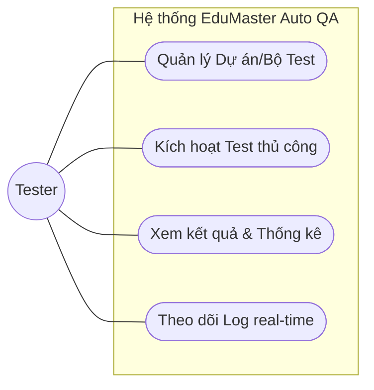
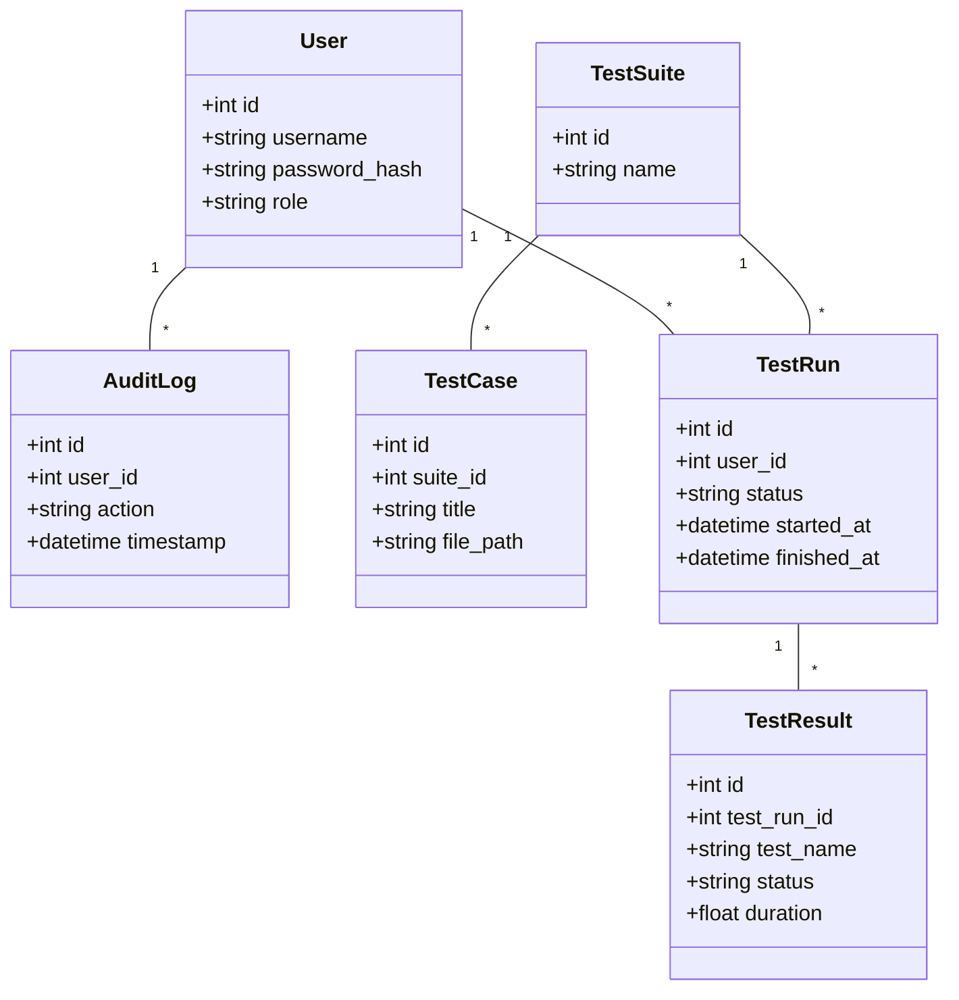
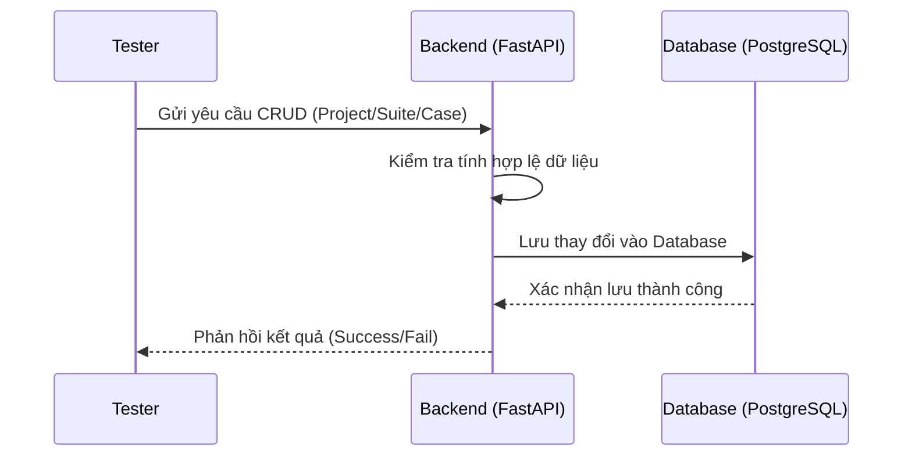
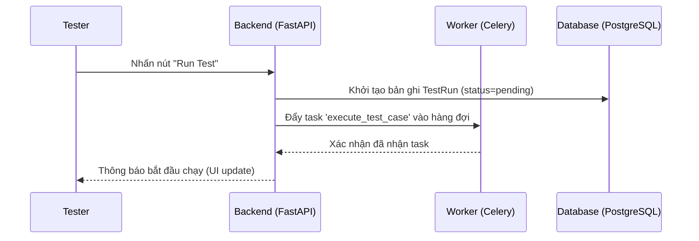
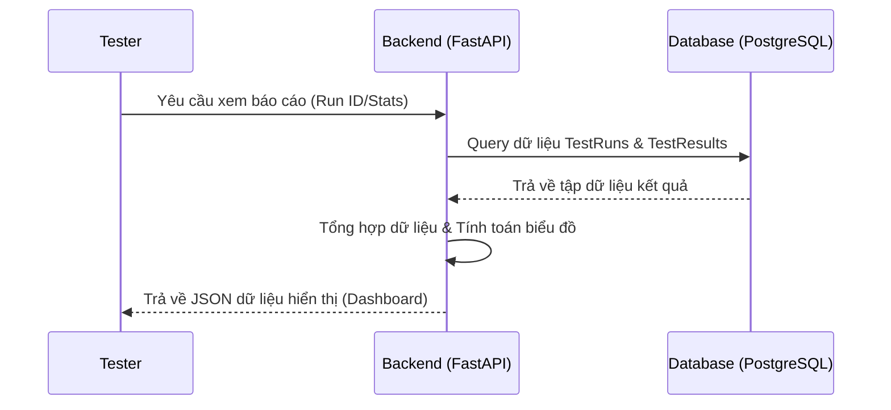
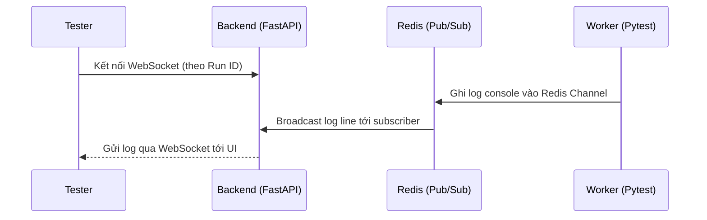

# Tài liệu Thiết kế Kiến trúc Tổng thể Hệ thống Kiểm thử Tự động EduMaster

## 1. Mô hình Kiến trúc Tổng thể
Hệ thống được thiết kế theo kiến trúc ba lớp (3-tier architecture) kết hợp với cơ chế hàng đợi công việc (Task Queue) để xử lý các bài kiểm thử nặng.

### Các lớp chính:
*   **Automation Framework (Lớp Kiểm thử):** Sử dụng Playwright và pytest. Tổ chức mã nguồn theo mô hình Page Object Model (POM). Đảm nhiệm việc tương tác với ứng dụng (UI) và gọi các endpoint API.
*   **Backend API (Lớp Xử lý dữ liệu):** Xây dựng trên FastAPI. Quản lý logic nghiệp vụ, điều phối việc thực thi test thông qua Celery và lưu trữ kết quả vào PostgreSQL.
*   **Dashboard (Lớp Hiển thị):** Giao diện React (Vite + HeroUI). Hiển thị kết quả kiểm thử, biểu đồ thống kê và luồng log thời gian thực từ Redis.

### Sơ đồ giao tiếp:
1.  **Dashboard <-> Backend:** REST API (HTTP) và WebSockets (cho log thời gian thực).
2.  **Backend <-> Celery/Redis:** Hàng đợi công việc và Pub/Sub cho logs.
3.  **Automation Framework <-> Database:** Ghi trực tiếp các kết quả thông qua API hoặc Parser sau khi kết thúc Run.
4.  **Automation Framework <-> EduMaster App:** Tương tác qua Browser (Playwright) hoặc HTTP Requests (pytest).

---

## 2. Các thành phần của hệ thống
*   **Automation Framework:** Bộ code Python/TypeScript thực thi test nằm trong thư mục `qa_core`.
*   **Test Runner:** Celery Worker (`qa_backend/app/tasks/test_tasks.py`) chạy các lệnh `pytest`.
*   **Result Collector:** Module phân tích report JSON (`app/utils/report_parser.py`) để cập nhật Database.
*   **FastAPI Backend:** Hệ thống API quản lý danh mục (`qa_backend/app/api`).
*   **PostgreSQL Database:** Lưu trữ dữ liệu quan hệ (`TestSuite`, `TestCase`, `TestRun`, `TestResult`).
*   **React Dashboard:** Giao diện quản trị tập trung (`qa_frontend`).
*   **Redis:** Đóng vai trò Broker cho Celery và kênh truyền tin (Broadcasting) log.

---

## 3. Biểu đồ Use Case

---

## 4. Đặc tả Use Case chi tiết

| Use Case | Mô tả chi tiết |
| :--- | :--- |
| **UC1: Quản lý Dự án/Bộ Test** | **Mô tả:** Tester quản lý cấu hình các Project, Suite và Test Case trong hệ thống. **Actor:** Tester **Trigger:** Tester muốn cập nhật danh sách test hoặc thay đổi cấu hình dự án. **Pre-conditions:** Đã đăng nhập vào hệ thống Dashboard. **Post-conditions:** Dữ liệu cấu hình được cập nhật chính xác trong PostgreSQL. **Luồng chính:** 1. Tester chọn module quản lý dự án. 2. Tester thêm mới hoặc chỉnh sửa Project/Suite/Case. 3. Hệ thống kiểm tra tính hợp lệ của đường dẫn file test. 4. Hệ thống lưu thông tin vào Database. **Luồng thay thế:** Nếu file path không tồn tại trên server runner, hệ thống hiển thị cảnh báo. |
| **UC2: Kích hoạt Test thủ công** | **Mô tả:** Tester chủ động chọn và chạy các bài kiểm thử từ giao diện Dashboard. **Actor:** Tester **Trigger:** Tester muốn kiểm tra tính năng hoặc hồi quy sau khi cập nhật ứng dụng. **Pre-conditions:** Các test case đã được cấu hình và runner đang sẵn sàng. **Post-conditions:** Bản ghi Test Run được tạo và task được gửi tới Celery. **Luồng chính:** 1. Tester chọn danh sách Test Case trên Dashboard. 2. Tester nhấn nút "Run Test". 3. Hệ thống khởi tạo Test Run với trạng thái 'pending'. 4. Hệ thống đẩy task 'execute_test_case' vào Celery. **Luồng thay thế:** Nếu không có worker nào hoạt động, task sẽ nằm trong hàng đợi Redis cho đến khi có worker sẵn sàng. |
| **UC4: Xem kết quả & Thống kê** | **Mô tả:** Xem lại lịch sử, kết quả chi tiết và biểu đồ thống kê chất lượng. **Actor:** Tester, Developer **Trigger:** Người dùng muốn đánh giá chất lượng phiên bản hoặc tìm nguyên nhân lỗi. **Pre-conditions:** Có ít nhất một Test Run đã kết thúc. **Post-conditions:** Thông tin kết quả và lỗi được hiển thị trực quan. **Luồng chính:** 1. Người dùng chọn mục 'Test Reports'. 2. Hệ thống truy vấn TestResults từ DB. 3. Hệ thống tính toán tỉ lệ Pass/Fail và tổng hợp thời gian chạy. 4. Hệ thống hiển thị biểu đồ và bảng danh sách lỗi chi tiết. **Luồng thay thế:** Nếu Test Run bị crash giữa chừng, hệ thống hiển thị trạng thái 'failed' và log lỗi hệ thống tương ứng. |
| **UC5: Theo dõi Log real-time** | **Mô tả:** Xem trực tiếp quá trình thực thi test đang diễn ra từng dòng một. **Actor:** Tester **Trigger:** Tester muốn debug hoặc kiểm tra tiến độ ngay khi test đang chạy. **Pre-conditions:** Một Test Run đang ở trạng thái 'running'. **Post-conditions:** Luồng log được stream liên tục lên màn hình Dashboard. **Luồng chính:** 1. Tester nhấn vào ID của Test Run đang chạy. 2. Dashboard mở kết nối WebSocket tới Backend. 3. Worker stream từng dòng log từ console vào Redis Channel. 4. Backend nhận dữ liệu từ Redis và đẩy qua WebSocket tới Dashboard. **Luồng thay thế:** Nếu kết nối mạng bị gián đoạn, Dashboard tự động cố gắng kết nối lại WebSocket. |

---

## 5. Class Diagram (Backend Models)

---

## 6. Biểu đồ Sequence (Trình tự)

### UC1: Quản lý Dự án/Bộ Test

### UC2: Kích hoạt Test thủ công

### UC4: Xem kết quả & Thống kê

### UC5: Theo dõi Log real-time

---

## 7. Thiết kế Automation Framework

### Mô hình Page Object Model (POM)
*   **Cấu trúc:** Tách biệt Locators và Actions.
*   **Pages (`qa_core/tests/ui/pages`):** Định nghĩa các element và phương thức tương tác (ví dụ: `LoginPage`, `ClassPage`).
*   **Specs (`qa_core/tests/ui/specs`):** Chứa kịch bản kiểm thử, sử dụng các Page Object để thực hiện thao tác và kiểm tra kết quả.

### Cơ chế quản lý Test Data
*   **Data Isolation:** Mỗi test case sử dụng dữ liệu riêng biệt, không phụ thuộc vào trạng thái của test case trước.
*   **Faker Library:** Sử dụng để sinh dữ liệu ngẫu nhiên (tên, email, số điện thoại) giúp tránh trùng lặp dữ liệu trong database.
*   **Environment Variables:** Quản lý thông tin cấu hình (Base URL, Credentials) qua file `.env`.
